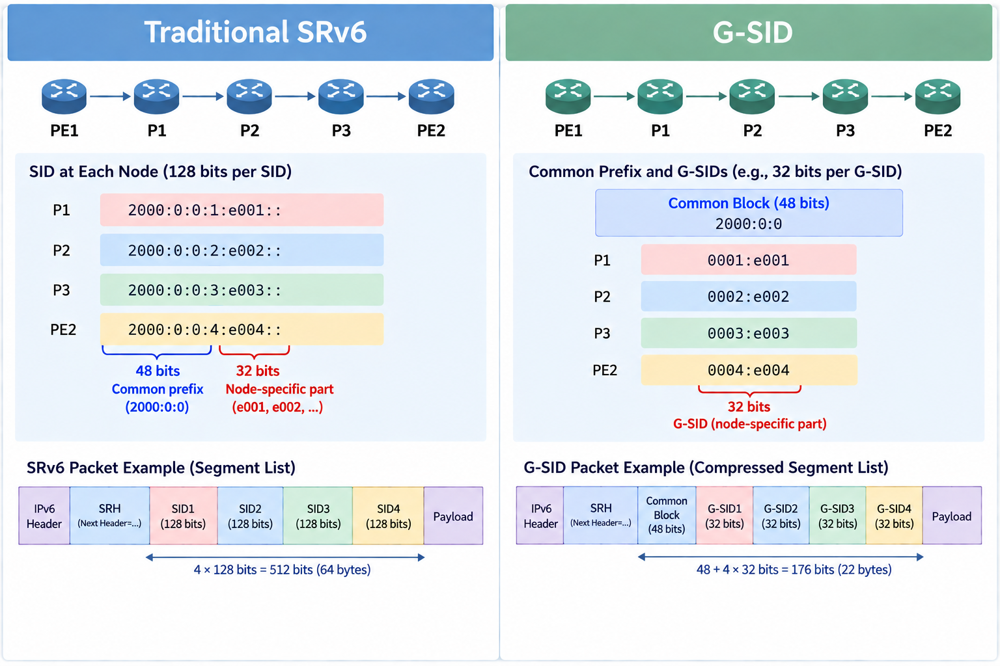
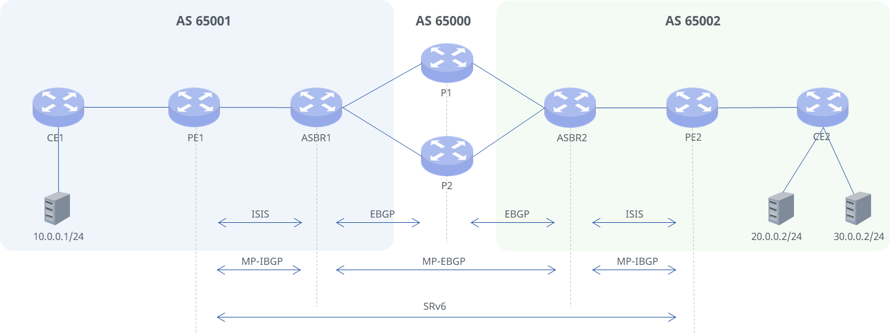
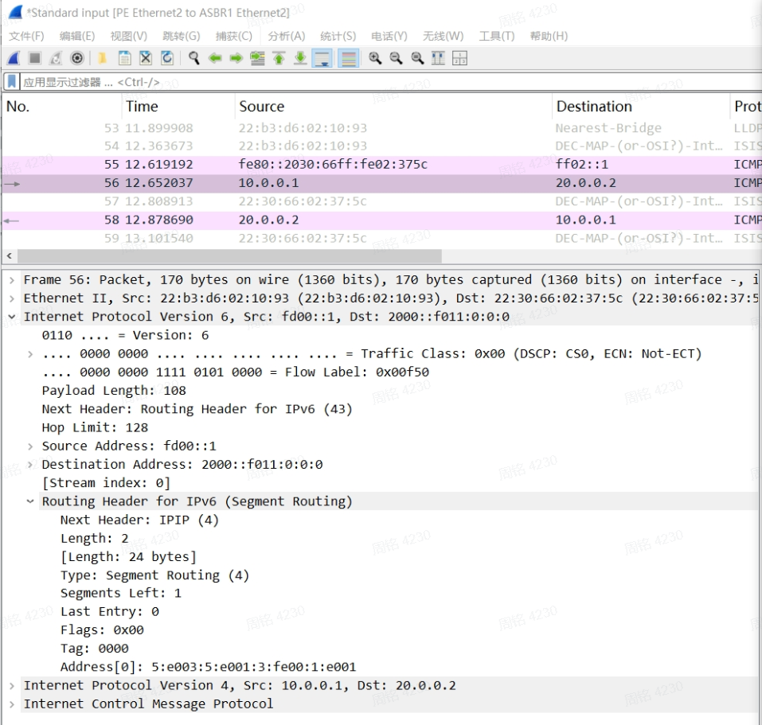
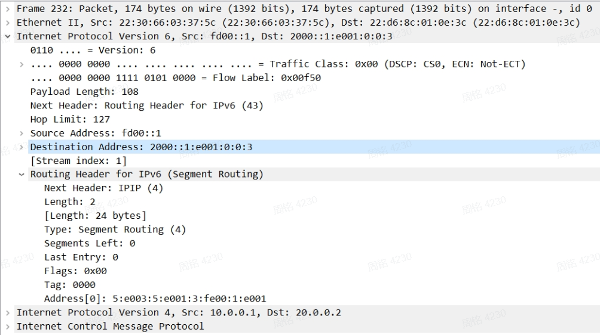

## Overview

In cross-data-center or cross-carrier networks, each network is typically managed as an independent autonomous system (AS). Inter-AS services require not only the exchange of VPN routes between ASs, but also that service traffic is forwarded along the intended path. SRv6 carries forwarding instructions in IPv6 addresses, providing a unified transport for inter-AS L3VPN services and supporting control over the transport path.

This case presents an SRv6 inter-AS networking solution that combines Inter-AS Option B, G-SID, and SR-TE Policy. VPN routes are exchanged between ASs using Option B; the ingress PE selects the inter-AS path based on the SR-TE Policy associated with the service route; and G-SID compresses the SIDs in the path to reduce packet encapsulation overhead.

### Technical Principles

#### Inter-AS Option B Solution

In the Inter-AS Option B solution, each AS maintains its own intra-AS underlay network independently, and ASBRs exchange VPN routes via MP-eBGP so that service sites in different ASs can communicate. Inter-AS VPN routes are passed through the ASBRs to the ingress PE, which performs SRv6 encapsulation on service packets based on the route information; the egress PE decapsulates the packets and forwards them to the destination VPN.

#### G-SID Encapsulation

In traditional SRv6, each SID occupies 128 bits. As the number of segments in a path grows, the SID list increases packet header overhead.

G-SID uses the address portion shared by multiple nodes as the Common Block, and uses shorter SIDs to represent individual nodes or forwarding behaviors. Four G-SIDs (4 x 32 bits) can be encoded in a single IPv6 address (128 bits). When a packet passes through a node, the node processes the current SID and updates the packet's IPv6 destination address so that the packet continues to be forwarded along the specified path.



In this case, G-SID compressed encoding is used in the Segment List of the SR-TE Policy to reduce the encapsulation overhead of the inter-AS explicit path.

## Typical Configuration Example

### Network Topology



#### IP Address Plan

| Link      | Local Interface | Local IP     | Remote Interface | Remote IP   |
|-----------|-----------------|--------------|-----------------|--------------|
| CE1-PE1   | CE1 Ethernet1   | 100.0.1.1/24 | PE1 Ethernet1   | 100.0.1.2/24 |
| PE1-ASBR1 | PE1 Ethernet2   | 1002::1/64   | ASBR1 Ethernet2 | 1002::2/64   |
| ASBR1-P1  | ASBR1 Ethernet3 | 1003::1/64   | P1 Ethernet1    | 1003::2/64   |
| ASBR1-P2  | ASBR1 Ethernet4 | 1010::2/64   | P2 Ethernet1    | 1010::1/64   |
| ASBR2-P1  | ASBR2 Ethernet3 | 2003::2/64   | P1 Ethernet2    | 2003::1/64   |
| ASBR2-P2  | ASBR2 Ethernet4 | 2010::2/64   | P2 Ethernet2    | 2010::1/64   |
| ASBR2-PE2 | ASBR2 Ethernet2 | 2002::1/64   | PE2 Ethernet2   | 2002::2/64   |
| PE2-CE2   | PE2 Ethernet1   | 200.0.0.2/24 | CE2 Ethernet1   | 200.0.0.1/24 |

#### Loopback Address and Locator Prefix Plan

| Device | Loopback0       | Locator Prefix  | SID                  | Behavior |
|--------|-----------------|-----------------|----------------------|----------|
| ASBR1  | 2000::1/64      | 2000::/64       | 2000::f011:0:0:0/80  | End      |
| P1     | 2000:0:0:1::/64 | 2000:0:0:1::/64 | 2000:0:0:1:e001::/80 | End      |
| P2     | 2000:0:0:2::/64 | 2000:0:0:2::/64 | 2000:0:0:2:e001::/80 | End      |
| ASBR2  | 2000:0:0:3::/64 | 2000:0:0:3::/64 | 2000:0:0:3:fe00::/80 | End      |
| PE1    | 2000:0:0:4::/64 | 2000:0:0:4::/64 | 2000:0:0:4:e002::/80 | End.DT4  |
|        |                 |                 | 2000:0:0:4:e000::/80 | End      |
| PE2    | 2000:0:0:5::/64 | 2000:0:0:5::/64 | 2000:0:0:5:e003::/80 | End.DT4  |
|        |                 |                 | 2000:0:0:5:e000::/80 | End      |

### Configuration Roadmap

1. Enable IPv6 forwarding on all interfaces of the PE, ASBR, and P devices, and configure interface IPv6 addresses

2. Enable IS-IS within each AS and configure the level

3. Configure VRFs on PE1 and PE2

4. Establish EBGP peer relationships between ASBRs and P devices

5. Establish MP-BGP peer relationships between PE1 and ASBR1, ASBR1 and ASBR2, and ASBR2 and PE2 to advertise VPN routes

6. Enable SRv6 on the PE, ASBR, and P devices, and configure Locator prefixes and SIDs

7. Configure route-maps to assign different Colors to different subnets

8. Create SR-TE Policies matching the Colors

### Service Configuration

#### Configure Interface and Loopback Addresses

Enable IPv6 forwarding on each interface and configure IPv6 addresses. PE1 is used as an example; the configuration on other devices is similar and is not repeated here.

```text
interface loopback 0
ip address 2000:0:0:4::1/64
exit

interface ethernet 2
router-interface
ip address 1002::1/64
ipv6 use-link-local
exit
```

#### Configure IS-IS

Both AS 65001 and AS 65002 use IS-IS Level-1 internally to build the IPv6 underlay. PE1 and ASBR1 are used as examples; the configuration on PE2 and ASBR2 is similar and is not repeated here.

**Configure PE1**

```text
router isis test
is-type level-1
net 10.0000.0000.0000.2222.00
redistribute ipv4 bgp level-1
redistribute ipv4 connected level-1
redistribute ipv6 bgp level-1
redistribute ipv6 connected level-1
exit

interface ethernet 2
ip router isis test
ipv6 router isis test
isis metric level-1 2
isis network point-to-point
no isis hello padding
exit
```

**Configure ASBR1**

```text
router isis test
is-type level-1
net 10.0000.0000.0000.3333.00
redistribute ipv4 bgp level-1
redistribute ipv4 connected level-1
redistribute ipv6 bgp level-1
redistribute ipv6 connected level-1
exit

interface ethernet 2
ip router isis test
ipv6 router isis test
isis network point-to-point
no isis hello padding
exit
```

After the configuration is complete, verify that IS-IS is configured successfully as follows.

**Display IS-IS neighbor information (PE1 as an example)**

```text
show isis neighbor
Area test
System Id Interface L State Holdtime SNPA
ASBR1 eth 2 1 up 29 2230.6602.375c
```

#### Configure VRFs and CE Access

Create VRF 100 on both PEs and establish an IPv4 IBGP neighbor with the CE within the VRF. CE1 and PE1 are used as examples below; the configuration on CE2 and PE2 is similar.

**Configure CE1**

```text
interface ethernet 1
router-interface
ip address 100.0.1.1/24
exit

interface ethernet 3
router-interface
ip address 10.0.0.2/24
exit

router bgp 65001
no bgp default ipv4-unicast
no bgp ebgp-requires-policy
neighbor 100.0.1.2 remote-as internal
address-family ipv4 unicast
neighbor 100.0.1.2 activate
redistribute connected
exit
exit
```

**Configure PE1**

```text
vrf 100
exit

interface ethernet 1
router-interface
ip address 100.0.1.2/24
vrf 100
exit

router bgp 65001 vrf 100
bgp router-id 1.1.1.1
no bgp default ipv4-unicast
no bgp ebgp-requires-policy
neighbor 100.0.1.1 remote-as internal
address-family ipv4 unicast
export vpn
import vpn
neighbor 100.0.1.1 activate
rd vpn export 3:20
rt vpn both 88:88
exit
exit
```

#### Configure EBGP Peers Between ASBRs and P Devices

Configure EBGP peers between ASBRs and P devices. ASBR1 and P1 are used as examples; the configuration between ASBR1 and P2, P1 and ASBR2, and P2 and ASBR2 is similar.

**Configure ASBR1**

```text
router bgp 65001
no bgp default ipv4-unicast
no bgp ebgp-requires-policy
neighbor 1003::2 remote-as 65000
neighbor 1003::2 capability extended-nexthop
neighbor 1003::2 ebgp-multihop 10
neighbor 1003::2 update-source 1003::1
address-family ipv4 unicast
neighbor 1003::2 activate
redistribute connected
exit
address-family ipv6 unicast
neighbor 1003::2 activate
redistribute connected
redistribute isis
exit
exit
```

**Configure P1**

```text
router bgp 65000
no bgp default ipv4-unicast
no bgp ebgp-requires-policy
egress-engineering enable
neighbor 1003::1 remote-as 65001
neighbor 1003::1 capability extended-nexthop
neighbor 1003::1 ebgp-multihop 10
neighbor 1003::1 update-source 1003::2
address-family ipv4 unicast
neighbor 1003::1 activate
redistribute connected
exit
address-family ipv6 unicast
neighbor 1003::1 activate
redistribute connected
exit
exit
```

#### Configure MP-EBGP/MP-IBGP Peers

Using PE1 and ASBR1 as an example, configure MP-IBGP peers to advertise VPN routes within the AS. The configuration between PE2 and ASBR2 is similar.

**Configure PE1**

```text
router bgp 65001
bgp router-id 1.1.1.1
no bgp default ipv4-unicast
no bgp ebgp-requires-policy
neighbor 2000::1 remote-as 65001
neighbor 2000::1 capability extended-nexthop
neighbor 2000::1 update-source 2000:0:0:4::1
address-family ipv4 unicast
redistribute connected
exit
address-family ipv4 vpn
neighbor 2000::1 activate
exit
address-family ipv6 unicast
redistribute connected
redistribute isis
exit
exit
```

**Configure ASBR1**

```text
router bgp 65001
neighbor 2000:0:0:4::1 remote-as 65001
neighbor 2000:0:0:4::1 capability extended-nexthop
neighbor 2000:0:0:4::1 update-source 2000::1
address-family ipv4 vpn
neighbor 2000:0:0:4::1 activate
neighbor 2000:0:0:4::1 next-hop-self
exit
exit
```

Configure the MP-EBGP peer between ASBR1 and ASBR2 to pass VPN routes across ASs.

**Configure ASBR1**

```text
router bgp 65001
neighbor 2000:0:0:3::1 remote-as 65002
neighbor 2000:0:0:3::1 capability extended-nexthop
neighbor 2000:0:0:3::1 ebgp-multihop 10
neighbor 2000:0:0:3::1 update-source 2000::1
address-family ipv4 vpn
neighbor 2000:0:0:3::1 activate
neighbor 2000:0:0:3::1 next-hop-self
exit
exit
```

**Configure ASBR2**

```text
router bgp 65002
neighbor 2000::1 remote-as 65001
neighbor 2000::1 capability extended-nexthop
neighbor 2000::1 ebgp-multihop 10
neighbor 2000::1 update-source 2000:0:0:3::1
address-family ipv4 vpn
neighbor 2000::1 activate
neighbor 2000::1 next-hop-self
exit
exit
```

Run show ipv6 bgp summary to check the BGP neighbor status of the device.

**Check the IPv6 BGP neighbor status on ASBR1**

```text
show ip bgp ipv6 summary

IPv6 Unicast Summary:
BGP router identifier 240.127.1.1, local AS number 65001 VRF default vrf-id 0
BGP table version 50 RIB entries 15, using 1920 bytes of memory Peers 2, using 48 KiB of memory

Neighbor V AS MsgRcvd MsgSent TblVer InQ OutQ Up/Down State/PfxRcd PfxSnt Desc
1003::2 4 65000 3267 3287 50 0 0 01:12:09 5 8 N/A
1010::1 4 65000 1716 1729 50 0 0 1d04h03m 5 8 N/A

Total number of neighbors 2

IPv6 VPN Summary:
BGP router identifier 240.127.1.1, local AS number 65002 VRF default vrf-id 0
BGP table version 0 RIB entries 3, using 384 bytes of memory Peers 2, using 48 KiB of memory

Neighbor V AS MsgRcvd MsgSent TblVer InQ OutQ Up/Down State/PfxRcd PfxSnt Desc
2000:0:0:3::1 4 65002 3227 3268 0 0 0 01:13:52 0 0 N/A
2000:0:0:4::1 4 65001 17 19 36 0 0 00:04:21 0 0 N/A
```

#### Configure SRv6 Capabilities

Using PE1 as an example, configure the SRv6 Locator and set the encapsulation format to gsid-f4832.

After the Locator prefix is configured, SIDs are generated automatically. SIDs can also be configured statically using the **sid** *sid* **locator** *locator-name* **behavior {End/End.X/End.DT4/End.DT6}** command. The configuration on PE2, ASBR1, ASBR2, P1, and P2 is similar:

**Configure PE1**

```text
segment-routing
srv6
locators
locator pe1
format gsid-f4832
prefix 2000:0:0:4::/64 block-len 48 node-len 16 arg-len 48
exit
exit
exit
exit
```

Enable SRv6 in the IS-IS process and associate the Locator. The configuration on PE2, ASBR1, and ASBR2 is similar:

**Configure PE1**

```text
router isis test
segment-routing srv6
locator pe1
exit
exit
```

Enable SRv6 in the BGP process and associate the local Locator ID so that BGP uses this Locator for SRv6 VPN services. The configuration on PE2, ASBR1, and ASBR2 is similar:

**Configure PE1**

```text
router bgp 65001
segment-routing srv6
locator pe1
exit
exit
router bgp 65001 vrf 100
address-family ipv4 unicast
sid vpn export auto
exit
exit
```

If SIDs are allocated dynamically, run the **show segment-routing srv6 local sid** command after the configuration to check SID allocation.

#### Configure Route-map

Taking the route for subnet 20.0.0.0/24 advertised from PE2 to PE1 as an example, create a route-map that sets the color of routes matching this subnet to 100.

```text
ip prefix-list test seq 10 permit 20.0.0.0/24
route-map test permit 10
match ip address prefix-list test
set extcommunity color 00:100
exit
router bgp 65002 vrf 100
address-family ipv4 unicast
route-map vpn export test
exit
exit
```

After the configuration is complete, verify that the VPN routes carry the specified Color as follows.

**View VPN route information on ASBR2**

```text
show bgp ipv4 vpn
BGP table version is 28, local router ID is 6.6.6.6, vrf id 0
Default local pref 100, local AS 65002
Status codes: s suppressed, d damped, h history, u unsorted, * valid, > best, = multipath,
i internal, r RIB-failure, S Stale, R Removed
Nexthop codes: @NNN nexthop's vrf id, < announce-nh-self
Origin codes: i - IGP, e - EGP, ? - incomplete
RPKI validation codes: V valid, I invalid, N Not found

Network Next Hop Metric LocPrf Weight Path
Route Distinguisher: 3:20
*>i 10.0.0.0/24 2000:0:0:3::1 100 0 65001 ?
UN=2000:0:0:3::1 EC{88:88} label=917536 sid=2000:0:0:4:: sid_structure=[48,16,16,48] type=bgp, subtype=0
*>i 10.1.0.1/32 2000:0:0:3::1 100 0 65001 ?
UN=2000:0:0:3::1 EC{88:88} label=917536 sid=2000:0:0:4:: sid_structure=[48,16,16,48] type=bgp, subtype=0
*> 20.0.0.0/24 200.0.1.2@15< 0 100 0 ?
UN=200.0.1.2 EC{88:88 Color:00:100} label=917552 sid=2000:0:0:5:: sid_structure=[48,16,16,48] type=bgp, subtype=5
*>i 100.0.1.0/24 2000:0:0:3::1 100 0 65001 ?
UN=2000:0:0:3::1 EC{88:88} label=917536 sid=2000:0:0:4:: sid_structure=[48,16,16,48] type=bgp, subtype=0
Displayed 4 routes and 4 total paths
```

#### Configure TE-Policy

Taking services for subnet 20.0.0.0/24 as an example, create a TE-Policy that specifies the forwarding path for this subnet as: PE1 -\> ASBR1 -\> P1 -\> ASBR2 -\> PE2.

**Configure the TE-policy for color 100 on PE1**

```text
segment-routing
traffic-eng
segment-list testpath
index 3 ipv6-address 2000::f011:0:0:0 compress csid-len 32 block-len 48
index 5 ipv6-address 2000:0:0:1:e001:: compress csid-len 32 block-len 48
index 10 ipv6-address 2000:0:0:3:fe00:: compress csid-len 32 block-len 48
index 15 ipv6-address 2000:0:0:5:e001:: compress csid-len 32 block-len 48
exit
policy test color 100 endpoint 2000::1
candidate-path 100 preference 100 explicit segment-list 100 testpath
exit
exit
```

After the configuration is complete, check the route information as follows.

**View route information on PE1**

```text
show ip route vrf all
Codes: K - kernel route, C - connected, L - local, S - static,
R - RIP, O - OSPF, I - IS-IS, B - BGP, E - EIGRP, N - NHRP,
T - Table, v - VNC, V - VNC-Direct, A - Babel, F - PBR,
f - OpenFabric, t - Table-Direct,
> - selected route, * - FIB route, q - queued, r - rejected, b - backup
t - trapped, o - offload failure

IPv4 unicast VRF 100:
B>* 10.0.0.0/24 [200/0] via 100.0.1.1, eth 1, weight 1, 01:54:02
B>* 10.1.0.1/32 [200/0] via 100.0.1.1, eth 1, weight 1, 01:54:02
B> 20.0.0.0/24 [200/0] via 2000::1 (vrf default) (recursive), SR-TE color 100, seg6 2000::f011:0:0:0,2000:0:0:1:e001::,2000:0:0:3:fe00::,2000:0:0:5:e001::,2000:0:0:5:e003::, weight 1, 00:08:57
* via fe80::2030:66ff:fe02:375c, eth 2 (vrf default), seg6 2000::f011:0:0:0,5:e003:5:e001:3:fe00:1:e001, encap behavior H.Encaps.Red, weight 1, 00:08:57
B 100.0.1.0/24 [200/0] via 100.0.1.1 inactive, weight 1, 01:25:15
C>* 100.0.1.0/24 is directly connected, eth 1, weight 1, 01:54:06
```

### Verification

1. Ping PC2 (20.0.0.2) on the right from PC1 to verify inter-AS connectivity for Color 100 services.


```text
PC1> ping -a 20.0.0.2

84 bytes from 20.0.0.2 icmp_seq=1 ttl=60 time=39 ms
84 bytes from 20.0.0.2 icmp_seq=2 ttl=60 time=27 ms
84 bytes from 20.0.0.2 icmp_seq=3 ttl=60 time=47 ms
84 bytes from 20.0.0.2 icmp_seq=4 ttl=60 time=27 ms
84 bytes from 20.0.0.2 icmp_seq=5 ttl=60 time=37 ms
84 bytes from 20.0.0.2 icmp_seq=6 ttl=60 time=35 ms
```

2. During the ping test, capture service packets between PE1 and ASBR1 and between ASBR1 and P1 to confirm G-SID encapsulation.

**Packets captured at the PE1 egress:**



**Packets captured at the ASBR1 egress:**


